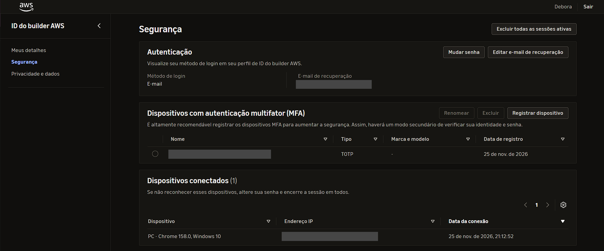
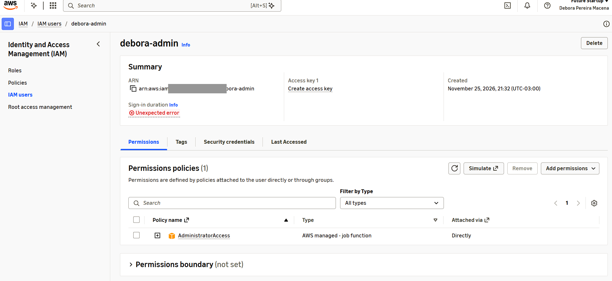
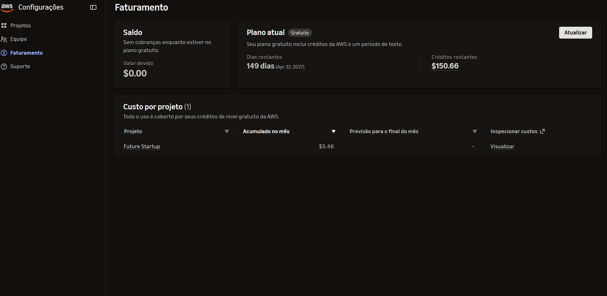

# Lab 00 – Segurança inicial da conta AWS

## Objetivo
Preparar uma conta AWS nova seguindo boas práticas de segurança e controle de custos antes de criar qualquer recurso.

## Serviços utilizados
- **AWS IAM** – usuários e políticas
- **MFA** – autenticação multifator
- **Billing / Cost and use** – acompanhamento de créditos e custos

## O que foi feito
1. Criação da conta no **Free Plan**
2. **MFA (TOTP)** ativado no AWS Builder ID usado para acessar o console
3. Usuário IAM **debora-admin** criado com a política `AdministratorAccess`, reservado para acesso programático (AWS CLI) nos próximos labs
   - O Free Plan não permite criar grupos no IAM, então a política foi anexada direto ao usuário. Em ambiente corporativo, o recomendado é atribuir permissões a grupos.
   - Nas contas novas, usuários IAM não têm login no console nem opção de MFA: o acesso ao console é feito pelo AWS Builder ID.
4. Controle de custos pelo painel **Cost and use**, acompanhando créditos restantes e custo do mês
   - O AWS Budgets não está disponível no Free Plan. Em compensação, o plano não gera cobrança no cartão: os custos são descontados dos créditos e a conta é encerrada quando eles acabam.

## Arquitetura
```
AWS Builder ID (MFA) ← login no console
        │
        └── IAM
             └── Usuário: debora-admin (AdministratorAccess) ← acesso via CLI nos próximos labs

Free Plan ──► custos descontados dos créditos (sem cobrança no cartão)
```

## Evidências
| Etapa | Print |
|---|---|
| MFA no acesso principal |  |
| Permissões do usuário |  |
| Créditos e custos |  |

> Prints com ID da conta e e-mails ocultados.

## Conceitos aplicados
- **Gestão de identidades:** login humano no console protegido com MFA; usuário IAM separado para automação
- **Grupos x permissão direta:** a boa prática é usar grupos; aqui foi aplicada permissão direta por limitação do Free Plan
- **Modelo de responsabilidade compartilhada:** a segurança do acesso à conta é responsabilidade do cliente
- **Controle de custos:** acompanhamento do consumo de créditos antes e depois de cada lab

## Dificuldades e aprendizados
- Em contas criadas a partir de out/2026, o MFA do acesso principal fica em **Profile → Gerenciar perfil → Segurança** (AWS Builder ID), e não mais em Security credentials.
- O Free Plan não permite criar grupos no IAM; a política foi anexada direto ao usuário.
- Usuários IAM não têm a seção Console sign-in nem MFA nas contas novas; o login no console é centralizado no AWS Builder ID.
- O AWS Budgets não aparece no Free Plan (a busca retorna apenas o Billing Conductor, sem acesso); o controle de custo foi feito pelo painel de créditos.
<!-- Complete com suas palavras: o que mais você não sabia e como resolveu. -->

## Próximo lab
[Lab 01 – Site estático no S3 + CloudFront](../lab-01-site-s3-cloudfront)
