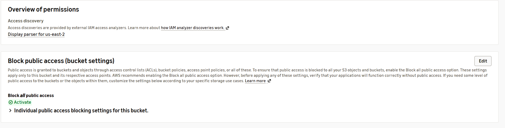
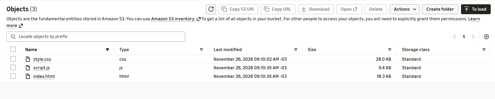
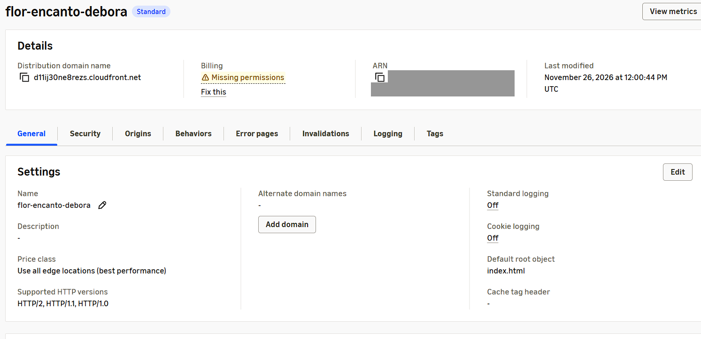
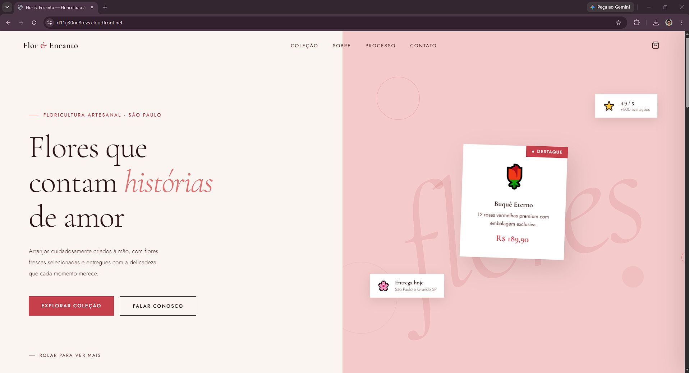

# Lab 01 – Site estático no S3 + CloudFront

## Objetivo
Hospedar o site [Flor & Encanto](https://github.com/DeboraMacena/flor-e-encanto) na AWS com um bucket S3 privado, distribuído pelo CloudFront com HTTPS.

🌐 **Site no ar:** https://d11ij30ne8rezs.cloudfront.net

## Serviços utilizados
- **Amazon S3** – armazenamento dos arquivos do site
- **Amazon CloudFront** – CDN com HTTPS e cache
- **Origin Access Control (OAC)** – acesso ao bucket restrito ao CloudFront

## Arquitetura
```
Usuário ──HTTPS──► CloudFront (cache + HTTPS)
                        │
                        │  OAC (somente esta distribuição)
                        ▼
                 S3: flor-encanto-debora (privado)
                   ├── index.html
                   ├── style.css
                   └── script.js
```

## O que foi feito
1. Bucket **S3** criado em `us-east-2` com **Block all public access** ativado
2. Upload de `index.html`, `style.css` e `script.js` na raiz do bucket
3. Distribuição **CloudFront** criada com origem S3 e **OAC**
4. **Bucket policy** liberando leitura (`s3:GetObject`) apenas para esta distribuição
5. **Default root object** definido como `index.html`
6. Teste de acesso pelo domínio `*.cloudfront.net` com HTTPS

### Bucket policy aplicada
```json
{
  "Version": "2008-10-17",
  "Id": "PolicyForCloudFrontPrivateContent",
  "Statement": [
    {
      "Sid": "AllowCloudFrontServicePrincipal",
      "Effect": "Allow",
      "Principal": { "Service": "cloudfront.amazonaws.com" },
      "Action": "s3:GetObject",
      "Resource": "arn:aws:s3:::flor-encanto-debora/*",
      "Condition": {
        "ArnLike": {
          "AWS:SourceArn": "arn:aws:cloudfront::<ACCOUNT_ID>:distribution/<DISTRIBUTION_ID>"
        }
      }
    }
  ]
}
```

## Decisões de configuração
| Configuração | Escolha | Motivo |
|---|---|---|
| Acesso público ao bucket | Bloqueado | Só o CloudFront lê os arquivos, via OAC |
| Static website hosting do S3 | Não usado | Exigiria bucket público |
| Price class | All edge locations | Inclui servidores na América do Sul |
| WAF | Desativado | Custo mensal fixo; site estático sem formulário ou login. Em produção, seria recomendado |
| Origin Shield / Logging | Desativados | Custo extra sem necessidade para o lab |

## Evidências
| Etapa | Print |
|---|---|
| Bucket privado |  |
| Arquivos na raiz |  |
| Distribuição CloudFront |  |
| Site no ar |  |

> Prints com ID da conta ocultado.

## Dificuldades e aprendizados
- **Access Denied ao abrir o site:** os arquivos foram enviados dentro de uma pasta, e não na raiz do bucket. O S3 responde *Access Denied* (e não *Not Found*) quando o objeto não existe no caminho pedido e o solicitante não tem permissão de listar o bucket. Solução: mover os arquivos para a raiz.
- **Default root object:** sem `index.html` configurado, o endereço principal da distribuição retorna erro, mesmo com os arquivos corretos.
- **Cache de erro:** depois de corrigir, o CloudFront pode continuar mostrando o erro por um tempo. Uma invalidação (`/*`) ou alguns minutos de espera resolvem.
- **WAF ativado por padrão:** o assistente de criação deixa as proteções de segurança ligadas; foram desativadas para evitar custo fixo no lab.
- **Aviso "Missing permissions" em Billing:** refere-se a planos de preço fixo do CloudFront (`pricingplanmanager:ListSubscriptions`) e não afeta o funcionamento da distribuição.

## Custo
Pay-as-you-go, sem mensalidade. Para um site de portfólio com poucos acessos, o custo fica em centavos e é descontado dos créditos do Free Plan.

## Próximo lab
Lab 02 – Servidor web no EC2
